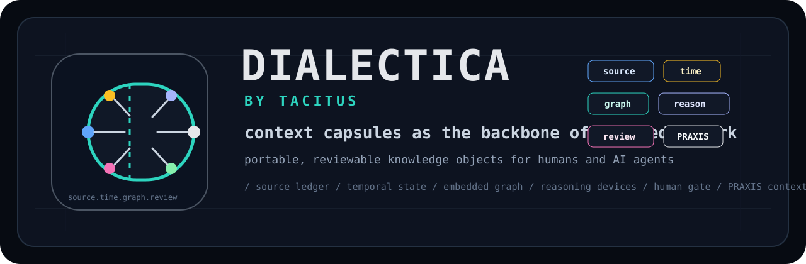

<p align="center">
  
</p>

<p align="center">
  
  
  
  <a href="https://github.com/sargonxg/A3_DIALECTICAbyTACITUS_v3/actions/workflows/docs.yml"></a>
</p>

# DIALECTICA

**The TACITUS context-capsule engine for PRAXIS.**

DIALECTICA is a Rust-first system for building, validating, reviewing, storing, and exporting portable context objects. A PRAXIS Capsule keeps evidence, temporal status, graph structure, analytical guidance, review decisions, caveats, and output rules together so that analysts and AI agents can work from the same inspectable context.

> **Active experimental software.** DIALECTICA has functioning local contracts, fixture workflows, capsule archives, import receipts, MCP tools, and API surfaces. It is not yet a complete cloud ingestion product or a production PRAXIS deployment.

## 30-second read

- **Problem:** ordinary prompts and chat histories lose source trails, temporal status, reviewed language, and the reasoning constraints that make policy work defensible.
- **Approach:** compile source material and expert guidance into a typed capsule with explicit provenance, review gates, and portable views.
- **Current implementation:** schema validation, source-pack checks, deterministic fixture extraction, capsule archive writing, context-pack export, local import receipts, MCP tools, and Axum fixture APIs.
- **Not yet complete:** production document ingestion, OCR, authentication, durable cloud jobs, live-provider evaluation, and full PRAXIS frontend integration.

## What is a PRAXIS Capsule?

A capsule is a portable bundle with two related layers:

1. **Substrate:** the sources, spans, entities, claims, temporal state, graph, metadata, and provenance available for analysis.
2. **Guidance:** the methods, review notes, caveats, terminology, audience constraints, and output contracts that shape how the substrate may be used.

A capsule is intended to make context inspectable rather than invisible. Reviewers should be able to see what was extracted, what was inferred, what changed, which language was approved, and what remains uncertain.

Typical capsule contents include:

- a manifest and stable identifiers;
- a source ledger with document and span references;
- a temporal ledger for current, stale, superseded, contested, predicted, or unknown states;
- typed entities and relationships in `graph.jsonld`;
- reasoning guidance and domain-specific analytical tools;
- review decisions, caveats, and unresolved questions;
- language and audience constraints;
- output contracts for briefs, memos, scenarios, plans, and agent workflows;
- generated views for PRAXIS, MCP clients, and human inspection.

## Capsule classes

| Class | Primary purpose |
| --- | --- |
| **User** | Mandate, organization, audience, preferences, decision horizon, and working constraints |
| **Situation** | Events, actors, claims, interests, evidence, uncertainty, and live context |
| **Tool** | Analytical methods, intellectual frameworks, heuristics, and known failure modes |
| **Output** | Artifact lineage, citations, caveats, reuse rules, and handoff context |

The classes share a common contract but carry different content and review requirements.

## Architecture

```text
sources + notes + feeds + expert review
                  │
                  ▼
        validation and source ledger
                  │
                  ▼
     extraction and semantic planning
                  │
          ┌───────┴────────┐
          ▼                ▼
   temporal ledger     typed graph
          │                │
          └───────┬────────┘
                  ▼
        guidance and review gates
                  │
                  ▼
      portable PRAXIS Capsule archive
                  │
        ┌─────────┼─────────┐
        ▼         ▼         ▼
      PRAXIS     MCP      human review
```

The workspace separates capsule contracts, building, extraction, compilation, graph handling, storage, evaluation, CLI, API, MCP, task handling, and contract tests. The JSON and archive contracts are intended to remain more stable than any single model provider or deployment architecture.

## Local inspection

Requirements: Rust 1.81 or later.

```bash
git clone https://github.com/sargonxg/A3_DIALECTICAbyTACITUS_v3.git
cd A3_DIALECTICAbyTACITUS_v3
cargo test --workspace
cargo run -p dialectica-cli -- welcome
```

The fixture path is the appropriate starting point because it exercises contracts without implying that external-provider and cloud paths are production-ready. Review the coding ledger before relying on any capability claim.

## Repository map

| Path | Role |
| --- | --- |
| `crates/dialectica-capsule` | Capsule schemas, validation, and archive contracts |
| `crates/dialectica-builder` | Capsule assembly and build workflow |
| `crates/dialectica-extractor` | Structured extraction interfaces |
| `crates/dialectica-compiler` | Compilation and generated views |
| `crates/dialectica-graph` | Typed graph handling |
| `crates/dialectica-store` | Storage interfaces and receipts |
| `crates/dialectica-eval` | Evaluation surfaces |
| `crates/dialectica-cli` | Local command-line interface |
| `services/dialectica-api` | Axum API surface |
| `services/dialectica-mcp` | MCP tools and resources |
| `services/dialectica-task-handler` | Background-task boundary |
| `tests/dialectica-contract-tests` | Cross-component contract tests |

## TACITUS system map

```text
PRAXIS      analyst-facing workbench and agentic workflow surface
DIALECTICA  context-capsule compiler, review engine, and portable context layer
AGON        experimental evidence and conflict-perception engine
KAIROS      experimental temporal-analysis engine
TCGC        benchmark for structural conflict reasoning
```

The projects are complementary, not interchangeable. AGON and KAIROS may contribute typed analytical objects; DIALECTICA packages reviewed context and guidance; PRAXIS is the user-facing environment; TCGC provides an evaluation surface.

## Evidence and review boundaries

A valid capsule can still contain a mistaken extraction, an incomplete source base, or an analyst judgment that should be contested. Signatures and hashes establish integrity and lineage; they do not establish factual truth. Review status should never be presented as a substitute for source criticism, domain expertise, or institutional accountability.

Before processing sensitive material, review credential handling, provider data paths, storage, logs, access control, export behavior, and retention. Do not use experimental capsules to make unattended legal, employment, clinical, security, eligibility, or other high-impact decisions about individuals.

## Documentation

- [Documentation map](docs/README.md)
- [Current coding ledger](docs/CODING_LEDGER.md)
- [Next build plan](docs/NEXT_CODE_BUILD_PLAN.md)
- [Product definition](docs/ABOUT_DIALECTICA.md)
- [Build instructions](docs/DIALECTICA_v3_BUILD_INSTRUCTIONS.md)
- [MCP capsule builder](docs/CODEX_MCP_CAPSULE_BUILDER.md)

The coding ledger is the authoritative statement of implemented, partial, planned, and blocked work.

## License

Apache License 2.0. See [LICENSE](LICENSE).
